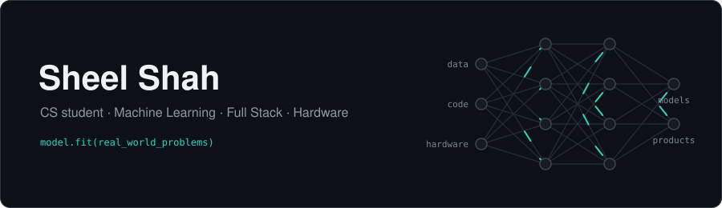

  

  I build things that leave the screen: ML models tested against real-world data, apps people use every day, and a Raspberry Pi that drives an electric car.

  
  
  

---

### ✦ Featured work

<table>
<tr>
<td width="50%" valign="top">

#### [OrbitTerp](https://github.com/Sheel2007/OrbitTerp)
Class-schedule optimizer for University of Maryland students. Pick courses, block off times and weight what matters (professor ratings, gaps between classes), and it returns the best-ranked schedules. Built on a **QUBO model** solved two ways, QAOA and classical, with live data from umd.io and PlanetTerp. Exports straight to calendar (`.ics`).

`React` `TypeScript` `FastAPI` `NumPy` `Qiskit`

</td>
<td width="50%" valign="top">

#### [Autonomous EV: Phase 1](https://github.com/Sheel2007/EVCar)
Computer-controlled throttle for a **Switch Labs electric vehicle**, built with a partner at Arlington Career Center. A Raspberry Pi drives an **MCP4725 DAC over I²C** to replace the pedal's 0–3.3 V signal, powered off the car's 12 V battery through a buck converter, with a touchscreen control panel. First of four phases toward self-driving. ([site](https://sheel2007.github.io/EVCar-Website/))

`Python` `Raspberry Pi` `I²C` `tkinter` `Electronics`

</td>
</tr>
<tr>
<td width="50%" valign="top">

#### [Home Board](https://github.com/Sheel2007/OMEGA-WB)
Touchscreen smart-home dashboard running 24/7 on a Raspberry Pi. Two-way Google Calendar sync, live football scores and line-ups, Zigbee light control, a phone-scannable grocery list and built-in games. Changes sync live across every screen. No framework, no build step.

`Python` `JavaScript` `Raspberry Pi` `Zigbee/MQTT` `systemd`

</td>
<td width="50%" valign="top">

#### [World Cup Predictor](https://github.com/Sheel2007/World-Cup)
Simulates the full 2026 World Cup, group stage to final. Trained on **8,000+ international matches**; XGBoost hit **57.5%** on 987 held-out games, beating a 6-qubit quantum SVM by 15 points. The bracket search then finds the most likely tournament.

`Python` `XGBoost` `scikit-learn` `pandas` `Qiskit`

</td>
</tr>
</table>

### ✦ More projects & research

| | |
|---|---|
| **[Published research](https://doi.org/10.1111/mms.13083)** | Contributor to a doctoral thesis, published in *Marine Mammal Science* |
| **[AI Tic-Tac-Toe](https://github.com/Sheel2007/AI-TicTacToe)** | Monte Carlo Tree Search agent, built for a master's course at Carnegie Mellon (Heinz College) |
| **[Aegis Orbit](https://github.com/KingXaney/Aegis-Orbit-)** | Hackathon team project: satellite collision-avoidance simulator. An XGBoost ranker scans an 18,598-object orbital catalog, physics screening confirms the threats, and an AI agent plans and explains avoidance burns on a 3D CesiumJS globe |
| **[Ping-Pong Launcher](https://github.com/Sheel2007/PingPong-Launcher)** | Hardware and Python control software for an automated ball-launching system |

---

### ✦ Toolbox

| | |
|---|---|
| **Languages** |       |
| **ML & Data** |        |
| **Web** |      |
| **Hardware & Systems** |     |
